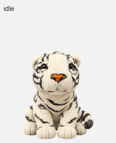

# Huhu · 呼呼

A little plush white tiger for your desktop. Native macOS and Windows apps, with the same saved artwork, nine animation states, and sixteen look directions. Runs offline, with no login, ChatGPT, API key, browser, or additional runtime required.



**[Download the latest release](https://github.com/ThatYT/Huhu/releases/latest)** · [All releases](https://github.com/ThatYT/Huhu/releases)

## Install

**Mac:** Open `Huhu-1.0.0-macos-universal.dmg`, drag Huhu into Applications, then open it. Supports Apple Silicon and Intel Macs on macOS 13 or later. Use the paw in the menu bar to hide/show or quit.

**Windows:** Run `Huhu-1.0.0-windows-x64-setup.exe`. Installs for your Windows user into `%LOCALAPPDATA%\Programs\Huhu`, adds Start Menu shortcuts, and registers an uninstaller in Windows Settings. No administrator installation is required. Supports Windows 10 (1703 or later) and Windows 11, x64. Use the Huhu icon in the notification area (possibly under the hidden-icons arrow) to hide/show or quit.

Portable ZIPs are also available. Extract the ZIP before running the app. Huhu does not add itself to login/startup items.

These initial packages are development builds: Windows is not Authenticode-signed and the Mac app is locally signed, not Developer ID signed or notarized. Public distribution should add the owner's signing credentials. The Mac app and DMG were validated locally. The Windows executable and installer were cross-compiled on macOS; Windows desktop and install/uninstall testing remain pending. The included CI performs native Windows build and artwork/gaze checks once uploaded to GitHub.

## Play

- Drag Huhu to move; its position is remembered.
- Click to wave; double-click to jump.
- Move your pointer nearby and Huhu looks toward it.
- Right-click Huhu or use its menu/tray icon for more animations, pointer-following, pause/resume, size, reset position, hide/show, and quit.
- System reduced-motion preferences use a still resting frame.

## Local data

Only size, position, and pointer-following preference are saved. macOS uses app preferences under `local.huhu.desktop`. Windows uses `%LOCALAPPDATA%\Huhu\settings.ini`; uninstalling preserves this small preference file. No networking, analytics, microphone, camera, screen capture, or accessibility access is used by the app.

## Build

### macOS

Install Apple's Command Line Tools, then run:

```sh
bash scripts/build-macos.sh
```

Produces a universal app, DMG, ZIP, and validation report in `dist/`. To select a different output folder, set `HUHU_DIST` to an absolute path.

### Windows

Use a Visual Studio Developer PowerShell with the Desktop development with C++ tools, Windows SDK, and NSIS installed:

```powershell
pwsh -File scripts/build-windows.ps1
```

Produces the app, installer, portable ZIP, and runtime artwork validation report in `dist/`.

### Cross-build Windows from macOS

```sh
brew install mingw-w64 makensis sevenzip
bash scripts/build-windows-cross.sh
```

Cross-compilation creates real Windows PE binaries but does not run Windows desktop tests. No Wine is required to build the installer.

### Animation logic tests

```sh
clang++ -std=c++17 -Wall -Wextra -Werror scripts/test-animation.cpp -o /tmp/huhu-animation-test
/tmp/huhu-animation-test
```

On either platform, the app's `--self-test` mode checks all 73 sprite frames, unused transparent cells, and sixteen gaze sectors. On Windows pass the JSON output path after `--self-test`.

## GitHub preparation

This folder is the repository root. It contains only the companion source and generated character artwork; the reference photograph, chat transcripts, pet account IDs, upload sessions, and credentials are excluded.

See [RELEASING.md](RELEASING.md) for the build and release workflow. No open-source license has been selected by the owner.
